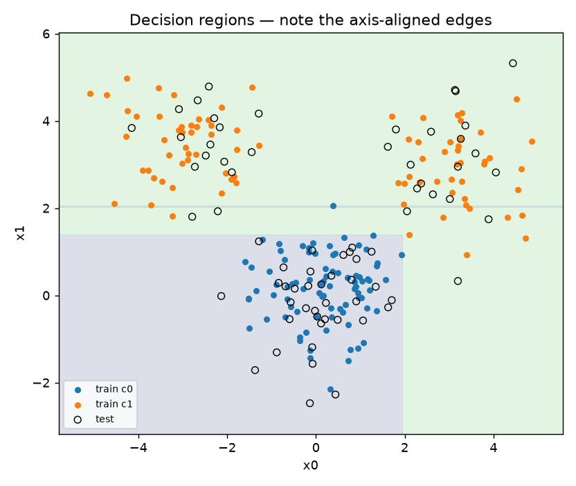
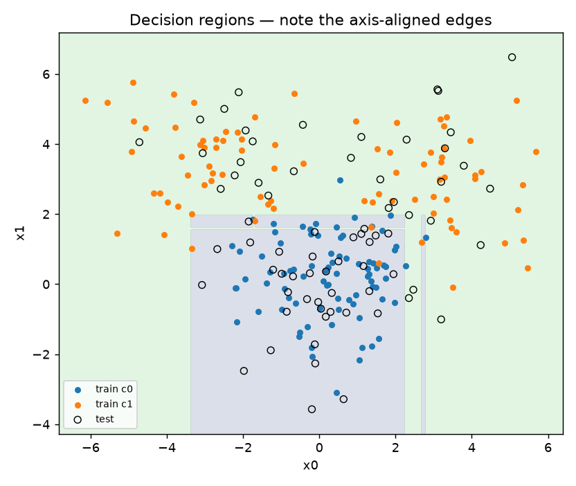
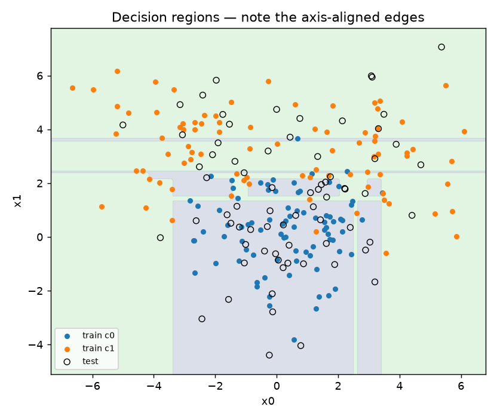
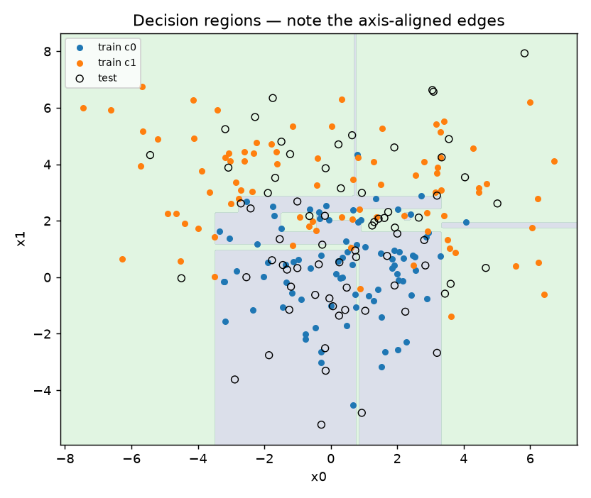

# CS676: Algorithms for Data Science

Dennis Meytin · Pace University · Fall 2026

This repository holds my work for CS676. Each deliverable lives in its own folder; this page says what is where.

## What is where

| Folder | Contents |
|---|---|
| [`homework/`](homework/) | The homework exercises, one folder each with the script and its report(s): [`01_lr.py`](homework/homework_1/01_lr.py) (linear regression), [`02_logreg.py`](homework/homework_2/02_logreg.py) (logistic regression), [`03_cv.py`](homework/homework_3/03_cv.py) (k-fold cross validation, with reports for k = 5, 7 and 10), [`04_tree.py`](homework/homework_4/04_tree.py) (decision tree from scratch, with reports and decision-region plots for fits 1, 2, 3 and 4, shown [below](#homework-4-decision-tree)); more added as assigned |
| [`projects/project_1/`](projects/project_1/) | **Project 1: Credibility Scoring** (see below) |
| `projects/project_2/` | Project 2 (not yet added) |
| `projects/project_3/` | Project 3 (not yet added) |

## Homework 4: Decision Tree

A classification tree grown from scratch with greedy Gini splitting, run on four versions of the same toy data. Each fit widens the spread of the classes, so they overlap more. Training accuracy is 1.0 every time because the tree is grown to purity; test accuracy is the number that counts.

| Fit | Spread (sd0 / sd1) | Leaves | Depth | Test accuracy | Report | Plot |
|---|---|---|---|---|---|---|
| 1 | 0.9 / 0.8 | 5 | 4 | 1.0000 | [report](homework/homework_4/04_tree_report_fit1.md) | [plot](homework/homework_4/04_tree_regions_fit1.png) |
| 2 | 1.3 / 1.2 | 14 | 9 | 0.9167 | [report](homework/homework_4/04_tree_report_fit2.md) | [plot](homework/homework_4/04_tree_regions_fit2.png) |
| 3 | 1.6 / 1.4 | 24 | 9 | 0.8889 | [report](homework/homework_4/04_tree_report_fit3.md) | [plot](homework/homework_4/04_tree_regions_fit3.png) |
| 4 | 1.9 / 1.7 | 27 | 12 | 0.7917 | [report](homework/homework_4/04_tree_report_fit4.md) | [plot](homework/homework_4/04_tree_regions_fit4.png) |

| Fit 1 | Fit 2 |
|---|---|
|  |  |
| **Fit 3** | **Fit 4** |
|  |  |

Regenerate everything from `homework/homework_4/` with `uv run --with numpy --with matplotlib 04_tree.py --all --plot --report`.

## Project 1: Credibility Scoring

A credibility scorer for web sources, plugged into a Streamlit research chatbot. Given a URL, `score_url()` returns a score between 0 and 1 and a plain-language explanation. I extended the provided baseline with preprint, subdomain, personal-page and sponsored-content rules, a real-metadata lookup through OpenAlex (retraction status, venue type, citations), better explanations, and a re-tuned blend between the rules and a Claude judgment.

**Headline result** (37 labelled URLs, language-model layer on): mean absolute error 0.117 to 0.060, and band accuracy (HIGH/MEDIUM/LOW) 81.1% to 94.6%. The full tables, how the blend weight was chosen, and the limitations are in [`projects/project_1/RESULTS.md`](projects/project_1/RESULTS.md). The technique report is [`projects/project_1/Project1_Report.pdf`](projects/project_1/Project1_Report.pdf).

| File | What it is |
|---|---|
| `credibility.py` | The scorer (the part I changed) |
| `evaluate.py` | Scores 37 labelled URLs and reports error |
| `test_credibility.py` | 77 offline checks |
| `main.py` | The Streamlit chat app (unchanged from the starter) |
| `RESULTS.md` | Results, what changed, and what still fails |
| `Project1_Report.pdf` | The technique report |

### Running it

This project uses [uv](https://docs.astral.sh/uv/). From `projects/project_1/`:

```bash
uv sync                                   # install the pinned dependencies
uv run python test_credibility.py         # 77 checks, no API key needed
uv run python evaluate.py                 # rules only, no key, no network
uv run python evaluate.py --metadata      # adds the OpenAlex lookup (free, needs network)
```

The chat app and the language-model layer need an Anthropic API key. Copy `.env.example` to `.env`, add your own key, then:

```bash
uv run python evaluate.py --llm --metadata   # final configuration (billed to your key)
uv run streamlit run main.py                 # the chat app
```

No real keys are stored in this repository; `.env` is git-ignored.
