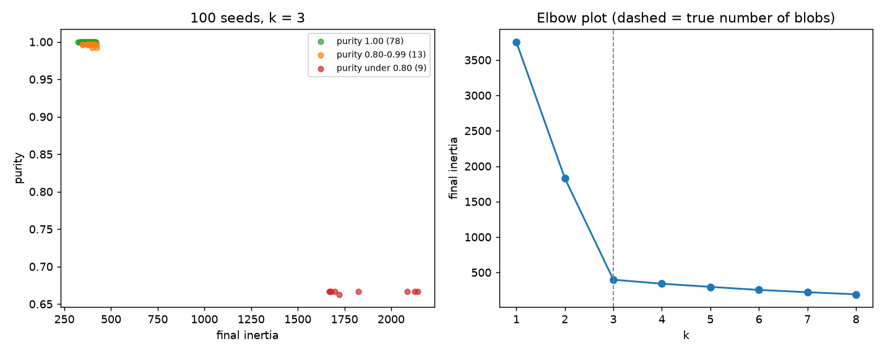

# Homework 05 — K-Means extras

The two "things to try" from the main report, run with `05_kmeans_sweeps.py`. It
reuses the finished functions from `05_kmeans.py` unchanged.

## 1. Seed sweep — k = 3, seeds 0 to 99

Each seed generates its own dataset and its own random starting centroids.

| outcome | runs | final inertia range |
| --- | --- | --- |
| purity 1.00 | 78 | 322 – 420 |
| purity 0.80-0.99 | 13 | 347 – 423 |
| purity under 0.80 | 9 | 1669 – 2141 |

Collapsed seeds: [23, 31, 33, 37, 38, 43, 66, 80, 93].

The collapsed runs have inertia 3.9x or more above the worst good
run (1669 vs 423), so inertia separates them cleanly without
needing any labels. Inertia cannot catch the near misses, where a few boundary
points sit in the wrong cluster. Those look normal.

## 2. k sweep — k = 1 to 8, best of 10 restarts per k

| k | final inertia | drop from k-1 |
| --- | --- | --- |
| 1 | 3755.65 | — |
| 2 | 1830.92 | 1924.7 |
| 3 | 397.60 | 1433.3 |
| 4 | 340.57 | 57.0 |
| 5 | 296.07 | 44.5 |
| 6 | 253.25 | 42.8 |
| 7 | 220.86 | 32.4 |
| 8 | 191.07 | 29.8 |

The elbow is at k = 3, the true number of blobs: the big drops
stop there and every later step is small. Inertia still falls at every k, because
more clusters always fit better, so it cannot be minimised to choose k. The elbow
is read off the shape of the curve instead. Taking the best of several restarts at
each k keeps a bad initialisation from putting a kink in that curve.

## Takeaway

K-means can converge, correctly obeying its own rules, to the wrong answer, and a
single run never says so. Restarts plus inertia are how you catch it on real data.
